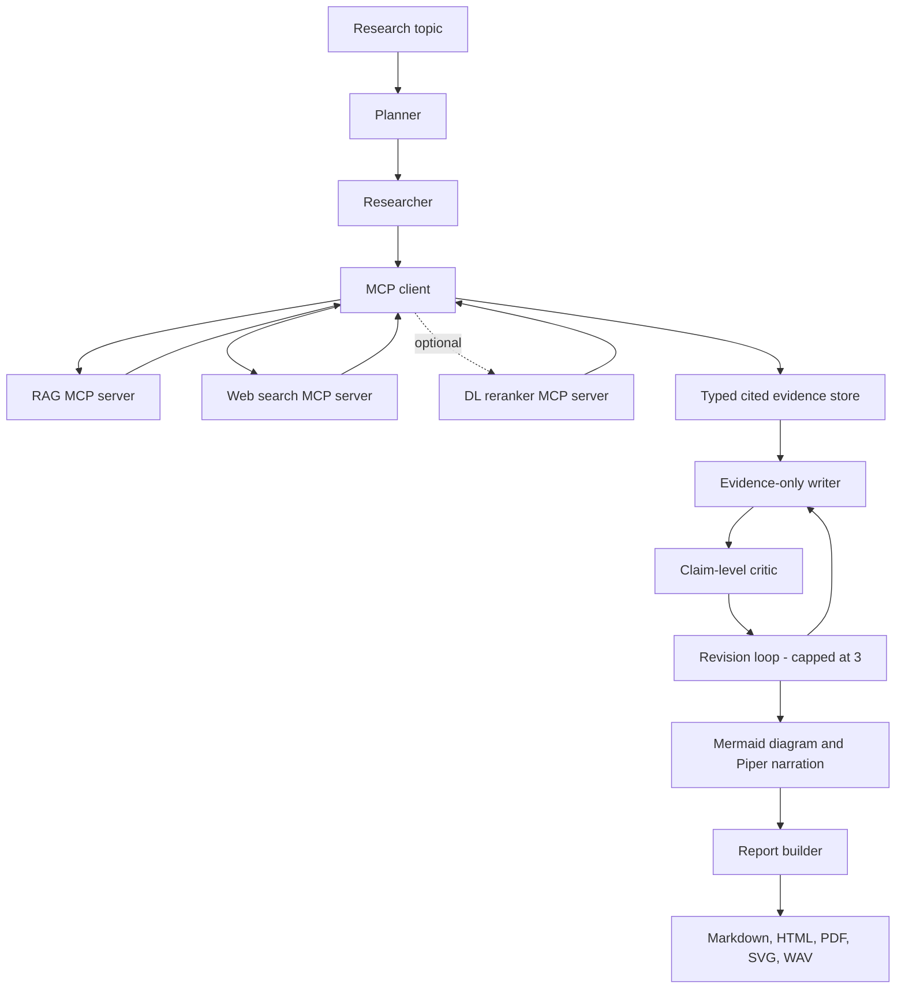

# ARA - Autonomous Research & Report Agent

ARA is a local-first research agent that searches local documents and the public web, gathers citation-ready evidence through MCP tools, drafts and critiques a report, then assembles Markdown, HTML, PDF, diagrams, and narrated audio. Reports preserve chunk IDs beside factual claims so readers can trace claims to retrieved passages.

ARA is a research prototype. On 2026-10-26 the Windows CPU host completed a fresh-clone setup, ingestion, and full local report run, and measured all four retrieval systems on the fixed 52-question set. The live report used the structural diagram and citation-grounded narration fallbacks after the small local model returned invalid Mermaid and a short narration script. See [measured results](#measured-results) and [known limits](#known-limits).

## Architecture



The researcher calls tools through the MCP client. Retrieved documents and web text are untrusted data. The writer uses only the evidence store, and the critic checks each claim against its citations and the research plan. Diagram generation validates a constrained Mermaid subset and has a built-in SVG renderer; Graphviz is optional. The DL cross-encoder is an opt-in post-retrieval ranker.

## Known limits

- The full report path passed both in the main checkout and in a fresh clone using Ollama 0.40.11, Qwen2.5, and EmbeddingGemma. The live run used validated fallbacks for invalid Mermaid and too-short narration; the local model's diagram and narration generation were not validated directly.
- The four-way retrieval table is measured on 52 questions and 33 chunks, but the sample corpus is small. Citation precision is candidate-chunk precision; answer-level citation accuracy, answer rate, and abstention were not measured.
- The DL model comparison covers 208 queries from an internal SciFact split, not the official test set. Results have no confidence intervals or significance tests; the random-negative control slightly exceeds the fine-tuned model on MRR/nDCG.
- Three live Writer/Critic runs covered distinct topics: one reduced unsupported claims from one to zero; two were clean on the first review. The 20-case reranker review now contains 20 observed first-rank failures, not padded successes.
- MCP stdio startup and tool discovery were verified with the SDK client. The Claude Desktop UI was not launched.
- GNU Make 4.4.1 is installed through MSYS2. A clean clone completed `make setup`, `make ingest`, and `make run`; the local Ollama service and ignored Piper voice files were reused.

## Quickstart

Requirements: Python 3.11 or newer, [uv](https://docs.astral.sh/uv/), and [Ollama](https://ollama.com/download). The configured chat model is `qwen2.5:1.5b`; the embedding model is `embeddinggemma`.

From the repository root, keep the uv cache, managed Python, and temporary files beside the checkout; then install the locked runtime and development extras, pull the configured Ollama models, download the pinned Piper voice, index the sample corpus, and run a report:

```powershell
$env:UV_CACHE_DIR = "$PWD/.tools/uv-cache"
$env:UV_PYTHON_INSTALL_DIR = "$PWD/.tools/uv-python"
$env:TEMP = "$PWD/.tools/tmp"
$env:TMP = $env:TEMP
New-Item -ItemType Directory -Force -Path $env:TEMP | Out-Null
uv sync --locked --extra dev --extra dl --extra tts
ollama pull qwen2.5:1.5b
ollama pull embeddinggemma
uv run --locked python -m ara.generative.tts --download-voice
uv run --locked ara ingest
uv run --locked ara run --topic "Grid-scale battery storage"
```

Ollama must be running at the URL in `config.yaml` (default `http://localhost:11434`). EmbeddingGemma requires Ollama 0.11.10 or newer. See the [Qwen2.5 model library](https://ollama.com/library/qwen2.5) and [EmbeddingGemma model library](https://ollama.com/library/embeddinggemma) for the configured model tags and download details.

A completed `ara run` starts the RAG and web-search servers as stdio child processes, writes a JSONL trace under `traces/`, and writes `report.md`, `report.html`, `report.pdf`, a diagram SVG, and a narration WAV under `outputs/<run-id>/`. Use `--until research` to stop after planning and evidence collection. Use `--max-revisions 0` to have the writer and critic make one pass without rewrites.

### Example report bundles

Three complete, curated examples exercise citation validation and the Markdown/HTML/PDF, SVG, and Piper audio outputs: [hybrid retrieval](outputs/examples/hybrid-retrieval/report.md), [citation provenance](outputs/examples/citation-provenance/report.md), and [untrusted evidence](outputs/examples/untrusted-evidence/report.md). They summarize local sample corpus notes with IDs from the production chunker; they are not live agent runs. Rebuild or validate them with the [example report guide](outputs/examples/README.md).

### CLI and Make targets

| Command | Purpose |
|---|---|
| `ara ingest [--source PATH]` | Load supported local sources and update the dense and BM25 indexes idempotently. |
| `ara ask QUESTION [--rerank]` | Answer from local hybrid retrieval with citations and abstention. `--rerank` needs the optional `rerank` extra and model weights. |
| `ara run --topic TOPIC [--until research]` | Run planning and research; by default continue through writing, critique, diagram, narration, and report assembly. |
| `python -m ara.web_app` | Open the local browser interface for a topic and optional multi-document upload. |
| `ara serve-mcp --server {rag,web-search,dl-model}` | Start one MCP server over stdio. |
| `ara rag-eval [OPTIONS]` | Compare dense, BM25, hybrid RRF, and reranked RRF retrieval; checkpoints each query for resume. |
| `ara train [OPTIONS]` | Train the custom evidence cross-encoder. Options are forwarded to `ara.dl.train`. |
| `ara eval [OPTIONS]` | Evaluate the custom cross-encoder against the retrieval baselines. Options are forwarded to `ara.dl.evaluate`. |

With GNU Make installed, `make setup`, `make ingest`, `make serve`, `make serve-web-search`, `make serve-dl-model`, `make web`, `make run TOPIC="..."`, `make train`, `make eval`, `make eval-rag`, `make test`, and `make lint` use locked uv commands. `make serve` starts the RAG server; each MCP server also has a separate target. Pass extra run, train, or eval flags with `ARGS`, for example `make run TOPIC="battery storage" ARGS="--until research"`; `make eval-rag ARGS=--fresh` starts a new 52-query evaluation and plain `make eval-rag` resumes it.

### Local browser interface and document uploads

Start the local interface with `make web`; the Makefile routes uv caches and temporary files to `.tools/` beside the checkout. It opens at `http://127.0.0.1:8765/` and accepts a research topic plus up to 20 PDF, DOCX, Markdown, TXT, or HTML files (20 MB per file, 50 MB total). Uploaded files are stored under ignored `data/web_sessions/` and combined with the sample corpus in an isolated per-run index; they do not modify the shared sample index. The app binds to loopback only, shows ingestion/research logs, and serves the generated report bundle for each completed run. Local Ollama handles model requests; topic-derived queries may go to the configured public search backend, so avoid entering sensitive details in the topic.

### Windows fallback without GNU Make

If GNU Make is unavailable, use the managed uv executable and a workspace-local cache:

```powershell
$env:UV_SYSTEM_CERTS = 'true'
$env:UV_CACHE_DIR = "$PWD/.tools/uv-cache"
$env:UV_PYTHON_INSTALL_DIR = "$PWD/.tools/uv-python"
$env:TEMP = "$PWD/.tools/tmp"
$env:TMP = $env:TEMP
New-Item -ItemType Directory -Force -Path $env:TEMP | Out-Null
.tools/uv/uv.exe sync --locked --extra dev --extra dl --extra tts
.tools/uv/uv.exe run --locked ara ingest
.tools/uv/uv.exe run --locked ara run --topic "Grid-scale battery storage" --until research
```

Override the Makefile's `UV` variable if uv is installed outside `PATH`, for example `make setup UV=.tools/uv/uv.exe`.

## MCP servers

ARA provides three independent MCP servers:

| Server | Tools | Behavior |
|---|---|---|
| `rag` | `search_knowledge_base`, `get_chunk` | Hybrid dense/BM25 retrieval and stable chunk lookup. |
| `web-search` | `web_search`, `fetch_page` | Free search backend and bounded, sanitized public-page fetch. Web evidence IDs use the `web:<hash>` format. |
| `dl-model` | `score_chunks` | Custom cross-encoder scoring; returns `not_ready` until a valid exported model is available. |

The [stdio verification record](docs/stdio_verification.md) shows all three servers started independently through the official MCP SDK client, exposed their tools, and returned the expected not-ready response from the DL service. Claude Desktop itself was not launched. The portable [Claude Desktop config example](docs/claude_desktop_config.example.json) contains placeholders that must be replaced with absolute paths.

Start a server directly with `uv run --locked ara serve-mcp --server web-search`, or use the Make targets. The `ara run` command starts the RAG and web servers it needs. Set `ARA_DL_USE_SCORER=true` only after training and exporting the scorer and making the DL MCP service available.

## Measured results

### Four-way RAG evaluation

The repository contains 52 labeled questions over the sample corpus: 34 factoid, 10 multi-hop, and 8 unanswerable. The live run indexed 21 documents into 33 chunks. Results use candidate depth 20 and metric cutoff 5; citation precision measures gold chunks among retrieved candidate IDs and does not run LLM answer generation. Full query rankings and reproduction details are in the [evaluation protocol](docs/evaluation.md).

| System | Recall@5 | MRR | nDCG@5 | Citation precision@5 |
|---|---:|---:|---:|---:|
| Dense | 0.989 | 0.924 | 0.923 | 0.204 |
| BM25 | 0.977 | 0.943 | 0.935 | 0.200 |
| Hybrid RRF | 0.989 | 0.989 | 0.971 | 0.204 |
| Hybrid RRF + reranker | 0.989 | 1.000 | 0.982 | 0.204 |

### Custom DL reranker

The reported comparison is measured on a 208-query **internal SciFact test split**, not the official SciFact test set. The checksum-pinned labeled train/dev subset has 693 queries split by evidence-document components into 415 train, 70 validation, and 208 test queries, with no document overlap. BM25 and dense retrieval each supplied their top 20 candidates; the union had candidate recall@20 of 0.9981 and averaged 33.38 candidates per query. Metrics are macro averages. No confidence intervals or significance tests were computed.

| System | Recall@10 | MRR | nDCG@10 |
|---|---:|---:|---:|
| BM25 + dense RRF, no reranker | 0.9923 | 0.9027 | 0.9236 |
| Generic MS MARCO cross-encoder | 0.9933 | 0.9282 | 0.9433 |
| Fine-tuned cross-encoder | 0.9933 | 0.9390 | 0.9504 |
| Random-negative control | 0.9933 | 0.9424 | 0.9530 |

The fine-tuned model improves MRR/nDCG over RRF and the generic cross-encoder on this split, while the random-negative control scores slightly higher on both. Treat the result as descriptive, not as evidence of a reliable generalization gain. The full [evaluation table](outputs/dl_evaluation_metrics.md), [20 observed first-rank failures](outputs/dl_error_analysis.json), and [model card](docs/model_card.md) include setup and limitations.

The expanded main training run used 934 train pairs and 155 validation pairs, seed 42, and three CPU epochs with early stopping; best validation BCE was 0.407094 at epoch 1. Training loss is not a ranking-quality metric; the held-out comparison above is the relevant model comparison. The [loss curve](outputs/dl_training_loss.png) and [training metrics](outputs/dl_training_metrics.json) are tracked.

### Agent-loop and integration checks

The revision-loop table below is a **scripted offline demonstration** using the real Writer, Critic, and RevisionLoop components with scripted drafts and judgments. It does not measure live-model quality.

| Scenario | Unsupported claims before | After | Revisions |
|---|---:|---:|---:|
| Hybrid retrieval | 1 | 0 | 1 |
| Citation provenance | 1 | 0 | 1 |
| Untrusted retrieved text | 1 | 0 | 1 |

The controlled researcher A/B uses one synthetic two-passage fixture. With the scorer disabled, the gold item ranked 2 (MRR 0.5000, one MCP call); with scoring enabled, it ranked 1 (MRR 1.0000, two MCP calls). This confirms integration wiring only, not a benchmark. Details are in [`outputs/dl_researcher_ab.md`](outputs/dl_researcher_ab.md) and the [P4.5 progress entry](docs/state/PROGRESS.md).

### Test and MCP checks

On the Windows CPU development host, the full suite passed **311 tests**; Ruff and MyPy were clean. The [stdio integration test record](docs/stdio_verification.md) covers the three MCP server processes. The report bundle and four-way RAG table were also generated in live local runs; the 52-question retrieval sample remains small and descriptive.

## Data, configuration, and artifacts

- `config.yaml` holds defaults. `.env` and `ARA_*` variables override them; copy `.env.example` to `.env` for local overrides. No model keys or paid API credentials are needed.
- Ingestion supports PDF, DOCX, Markdown, TXT, and HTML. The sample corpus contains 19 original explanatory notes; see [`data/sample_corpus/SOURCES.md`](data/sample_corpus/SOURCES.md) for attribution and licensing.
- The SciFact subset and pair data provenance are documented in [`data/dl_data/SOURCES.md`](data/dl_data/SOURCES.md). The trained checkpoint, export, Ollama weights, and Piper voice are local generated/downloaded assets under ignored `models/` paths.
- Traces are JSONL under `traces/`. Indexes are persisted under `data/indexes/`. Generated report bundles go under `outputs/`.
- To prepare or download the pinned SciFact subset, run `uv run --locked python -m ara.dl.public_data --download`. Training and evaluation also need the pinned Hugging Face base model weights.

## Tests and static checks

```powershell
uv run --locked --extra dev --extra dl --extra tts pytest
uv run --locked ruff check .
uv run --locked mypy src scripts
```

The default suite uses mocked local-LLM responses and offline MCP fixtures; it does not make Ollama or web-search requests. To reproduce the offline orchestration and revision demos, run `uv run --locked python scripts/offline_e2e_demo.py` and `uv run --locked python scripts/offline_revision_demo.py`.

## Troubleshooting

- **Ollama connection or model error:** start Ollama, check `llm.base_url`, and pull the configured tags with `ollama pull qwen2.5:1.5b` and `ollama pull embeddinggemma`. The `ara run` and `ara ask` commands need the configured chat/embedding models.
- **EmbeddingGemma rejected:** update Ollama to 0.11.10 or newer, as noted in its [model library page](https://ollama.com/library/embeddinggemma).
- **Narration voice missing:** run `uv run --locked --extra tts python -m ara.generative.tts --download-voice`. The voice download uses the pinned revision in `config.yaml`.
- **SciFact files missing:** run `uv run --locked --extra dl python -m ara.dl.public_data --download` from the repository root.
- **Reranker checkpoint missing:** run `uv run --locked --extra dev --extra dl ara train`, then `uv run --locked --extra dev --extra dl python -m ara.dl.export`. Checkpoint and export files are generated locally and are not committed.
- **GNU Make not found:** use the direct uv commands in the [Windows section](#windows-host-without-gnu-make), or install GNU Make and set `UV` if needed.
- **Hugging Face TLS/cache errors on this Windows host:** set `UV_SYSTEM_CERTS=true` and `UV_CACHE_DIR=.tools/uv-cache`. Importing `truststore` before Transformers is handled by the project's download paths; keep certificate verification enabled.

## Project notes

- [Detailed architecture](docs/architecture.md)
- [Design decisions and trade-offs](docs/design_decisions.md)
- [RAG evaluation protocol](docs/evaluation.md)
- [Reranker model card](docs/model_card.md)
- [MCP stdio verification](docs/stdio_verification.md)
- [Claude Desktop configuration example](docs/claude_desktop_config.example.json)
- [Session handoff and task state](docs/state/HANDOFF.md)
- [Project decisions](docs/state/DECISIONS.md)
