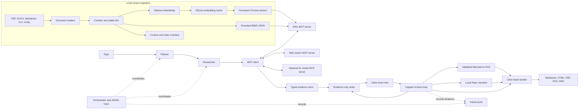

# ARA architecture

ARA is a local-first Python application with two entry paths: `ara ask` for a direct local RAG answer, and `ara run` for multi-agent research followed by report generation. The multi-agent path starts independent MCP stdio servers as child processes and calls them through the official Python SDK client.

## System flow

The direct `ara ask` path uses the same local hybrid retriever and answer/citation validator without running the Planner, Researcher, Writer, or Critic. The `ara run --until research` path stops after the orchestrator has completed planning and retrieval. The default `ara run` continues through writing, critique, diagrams, narration, and report assembly.

## Component responsibilities

| Area | Main modules | Responsibility |
|---|---|---|
| Configuration | `src/ara/config.py`, `config.yaml`, `.env.example` | Validated Pydantic settings; YAML defaults with dotenv and `ARA_*` overrides. |
| Ingestion | `src/ara/rag/ingest.py`, `chunking.py`, `indexing.py` | Load supported documents, retain source/page/character offsets, create stable chunk IDs, and reconcile index state using hashes and a manifest. |
| Dense retrieval | `src/ara/rag/embeddings.py`, `vectorstore.py` | Call the local Ollama embedding endpoint, cache vectors by model/text hash, and persist dense vectors with Chroma. |
| Lexical and hybrid retrieval | `src/ara/rag/bm25.py`, `retriever.py` | Persist local BM25 records and combine dense and lexical ranks with weighted reciprocal-rank fusion. |
| RAG answer | `src/ara/rag/answer.py`, `src/ara/agents/citations.py` | Generate structured claims, validate cited IDs, and abstain when evidence does not pass the configured gate. |
| MCP servers and client | `src/ara/mcp_servers/`, `src/ara/mcp_client/client.py` | Expose local retrieval, bounded web search/fetch, and optional chunk scoring over independent stdio processes. |
| Agents | `src/ara/agents/` | Keep a typed plan/evidence/draft state; research through MCP; write from evidence; critique claims; cap and trace revisions. |
| Custom DL ranker | `src/ara/dl/` and `dl_model_server.py` | Fine-tune a MiniLM relevance cross-encoder, evaluate it against retrieval baselines, and load an exported model lazily through MCP. |
| Generative output | `src/ara/generative/` | Validate Mermaid syntax, render diagrams to SVG, synthesize a pinned local Piper voice, and assemble cited Markdown/HTML/PDF bundles. |
| CLI | `src/ara/cli.py` | Expose ingestion, direct ask, MCP server startup, full topic runs, model training, and model evaluation. |

## Ingestion and retrieval

1. Loaders extract text and provenance from PDF, DOCX, Markdown, TXT, and HTML sources.
2. Chunking records the source name, page when available, character offsets, and a stable `chunk:` ID. Chunk size and overlap are configurable.
3. Ingestion compares source hashes, chunk IDs, embedding model, and both indexes with a manifest. Unchanged state skips embedding work; changed inputs upsert current chunks and remove stale dense IDs.
4. The dense path uses an Ollama embedding model and persistent Chroma storage. The lexical path uses the project BM25 implementation with a versioned JSON index. Embedding vectors are cached in SQLite without storing source text.
5. Hybrid retrieval requests candidate lists from both indexes and fuses one-based ranks with weighted RRF. Defaults are equal weights and `k=60`; the optional generic Sentence Transformers CrossEncoder can rerank a bounded candidate set.
6. The answerer creates structured claims with evidence IDs, renders citations in code, checks that IDs exist, and abstains when no candidate meets the configured floor.

## Research and report flow

1. The Planner emits a validated acyclic plan of 3-8 tasks.
2. The Orchestrator starts a typed run and writes append-only JSONL trace events. The Researcher selects from a fixed tool allowlist and calls the named `rag` and `web` servers through `MCPClient`; it enforces per-run tool/evidence budgets and retains local or `web:` evidence with provenance.
3. The optional DL scorer is called through the `dl-model` MCP server only after local retrieval. It reorders candidate chunk IDs; missing, invalid, or unavailable scores preserve the original order.
4. The Writer receives the plan and bounded evidence store, returns structured atomic claims, and cannot add a citation ID outside that context. The Critic independently checks citation syntax and membership before assessing support, gaps, and contradictions. The RevisionLoop stops when clean, abstained, unchanged, or at the revision cap (default three).
5. For a non-abstaining draft, the diagram generator asks the local model for a restricted Mermaid flowchart, validates it, and renders SVG with Graphviz when available or a built-in fallback. The narration generator asks the local model for a 170-260 word spoken summary; Piper writes a validated WAV.
6. The report builder validates citations again, derives a references section from cited evidence, copies local figure/audio assets, and writes Markdown, HTML, and A4 PDF outputs.

Each factual claim is expected to carry `[chunk:<id>]` or `[web:<id>]`. Deterministic validation confirms that citation IDs exist in the supplied evidence map; the LLM critic's support judgment is not a formal entailment proof.

## Trust boundaries and failure behavior

- Retrieved documents and web text are always untrusted data. Prompts serialize evidence as data and instruct models to ignore instructions embedded in it.
- Researchers can call only named tools with validated inputs. Web fetches bound redirects, time, response size, and extracted text; page content is sanitized before it becomes evidence.
- MCP tool calls, model outputs, citations, diagrams, audio, and report asset paths are validated at their owning boundary. Trace records keep bounded metadata and omit raw retrieved text.
- Empty/weak evidence leads to abstention. The DL service returns a typed `not_ready` response before an export exists. Optional scorer failures fall back to the prior retrieval order.
- Models are loaded lazily where possible. Imports and server startup do not require live network access to load Ollama, Piper, or Hugging Face weights.

## Runtime and persistence

All defaults are in `config.yaml`; environment overrides use `ARA_*` variables. Ollama serves chat and embedding locally. `ara run` starts the RAG and web-search MCP subprocesses required for a run and starts the DL subprocess only when `ARA_DL_USE_SCORER=true`. Each MCP server can also be launched independently with `ara serve-mcp --server ...`.

Indexes are written under `data/indexes/`, model checkpoints/voice assets under ignored `models/`, JSONL traces under `traces/`, and report bundles under `outputs/<run-id>/`. The training/evaluation split and pinned base weights are documented in [`model_card.md`](model_card.md). The checked-in stdio verification shows protocol startup and tool discovery; it does not verify the Claude Desktop UI.

## Validation status

The Python test suite covers loaders, chunking, indexing, retrievers, citations, agent state, MCP in-memory and stdio flows, scripted Writer/Critic runs, DL training/inference wrappers, diagrams, TTS, report output, and the resumable four-system retrieval evaluation. The checked-in [example reports](../outputs/examples/README.md) are curated, source-grounded bundles generated through the report pipeline. The last full suite passed 311 tests on a CPU-only Windows host; Ruff and MyPy were clean.

The fresh-clone `make setup`, `make ingest`, and `make run` path passed on the Windows CPU host. The four-way RAG evaluation measured 52 questions over 33 chunks; candidate precision and ranking metrics are descriptive and do not measure generated-answer citation accuracy. The custom ranker result is measured on 30 queries from an internal SciFact test split, not the official test set. Live three-topic revision quality, the required 20-case DL error review, and Claude Desktop UI verification remain open. See [`evaluation.md`](evaluation.md), [`model_card.md`](model_card.md), and [`state/BLOCKERS.md`](state/BLOCKERS.md) for detail.
