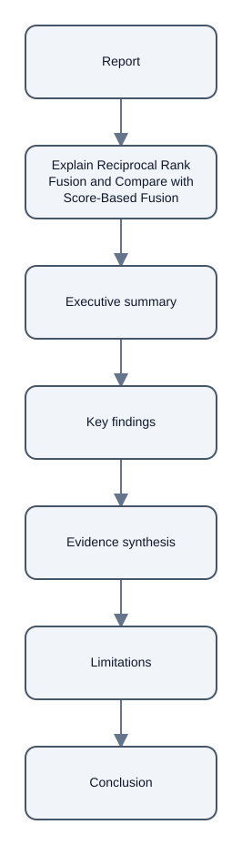

# Explain Reciprocal Rank Fusion and Compare with Score-Based Fusion

## Executive summary

- Reciprocal Rank Fusion (RRF) combines ranked lists using the positions of shared candidates rather than adding raw scores. This method is less sensitive to incompatible scales and preserves different information compared to Distribution-Based Score Fusion (DBSF). [chunk:18d1df5053760571bfe1]

## Key findings

- Reciprocal Rank Fusion (RRF) combines ranked lists using the positions of shared candidates rather than adding raw scores. [chunk:18d1df5053760571bfe1]

## Evidence synthesis

- RRF is less sensitive to incompatible scales and preserves different information compared to Distribution-Based Score Fusion (DBSF). [chunk:18d1df5053760571bfe1]

## Limitations

- Neither rule is guaranteed to win for every corpus. Compare them on the same held-out questions, using the same component retrievers, candidate depths, and relevance labels. [chunk:18d1df5053760571bfe1]

## Conclusion

- RRF is a useful method for combining ranked lists, but it is not guaranteed to outperform other methods. [chunk:18d1df5053760571bfe1]

## Diagrams

## Audio summary

[Listen to the 73-second narrated summary](audio/narration.wav)

## References

- Citation ID: `chunk:18d1df5053760571bfe1` - Source: 05\_fusion\_is\_not\_universal\.md
