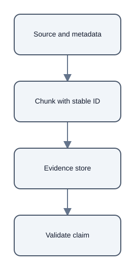

# Citation Provenance: Stable IDs Connect Claims to Evidence

## Summary

A citation-ready passage needs a stable identifier that connects the indexed text to its source. [chunk:d0294bd3e2035d9f5328]

## Provenance metadata

Useful metadata includes the source path or URL, a page when available, and character offsets in the extracted document. [chunk:d0294bd3e2035d9f5328]

The source note says an identifier should be deterministic for the same source and chunking settings, allowing evaluation records to keep pointing to the same evidence. [chunk:d0294bd3e2035d9f5328]

## Validation

When a report cites a chunk, validate that its ID exists in the evidence store, then resolve the ID to stored text and metadata before review. [chunk:d0294bd3e2035d9f5328]

That process makes a citation a verifiable connection between a claim and its offered passage. [chunk:d0294bd3e2035d9f5328]

## Scope

This example explains the corpus note's provenance guidance; it does not claim that all identifiers remain stable after source or chunking changes. [chunk:d0294bd3e2035d9f5328]

## Diagrams

## Audio summary

[Listen to the 72-second narrated summary](audio/narration.wav)

## References

- Citation ID: `chunk:d0294bd3e2035d9f5328` - Source: 11\_chunk\_citation\_metadata\.md
