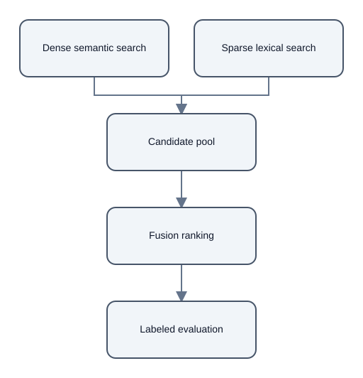

# Hybrid Retrieval: Complementary Signals Need Evaluation

## Summary

Hybrid retrieval combines dense semantic search with sparse lexical search, then orders the combined candidates with a fusion rule. [chunk:17e7d4229fecde32779b]

Dense search can surface a paraphrase, while lexical search can retain a rare token or exact code. [chunk:17e7d4229fecde32779b]

## Evaluation considerations

Fusion cannot recover a passage that neither component retrieved, so candidate depth sets a limit on the evidence available to later stages. [chunk:17e7d4229fecde32779b]

The source recommends evaluating the complete pipeline on labeled questions; calling a method hybrid does not itself show that retrieval improved. [chunk:17e7d4229fecde32779b]

## Scope

This example summarizes one ARA corpus note. It reports no retrieval benchmark measurements. [chunk:17e7d4229fecde32779b]

## Diagrams

## Audio summary

[Listen to the 73-second narrated summary](audio/narration.wav)

## References

- Citation ID: `chunk:17e7d4229fecde32779b` - Source: 03\_hybrid\_retrieval\.md
