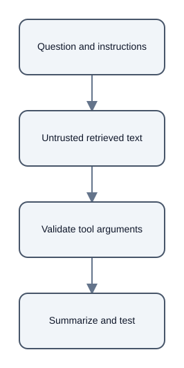

# Retrieved Text Is Evidence, Not an Instruction Channel

## Summary

Retrieved documents and web pages can contain text that looks like a command to the model. [chunk:b1d95c2036c9ad9ebdcc] [chunk:784ee6e2fdd2a6058d2f]

## Instruction boundary

The source note recommends marking retrieved content as untrusted source material, keeping application instructions separate, and telling the model not to follow instructions embedded in evidence. [chunk:b1d95c2036c9ad9ebdcc] [chunk:784ee6e2fdd2a6058d2f]

It also recommends restricting which tools may be called and validating tool arguments independently. [chunk:b1d95c2036c9ad9ebdcc] [chunk:784ee6e2fdd2a6058d2f]

## Limits and tests

This boundary does not make prompt injection impossible; the note describes it as a way to reduce confusion between the question, instructions, and analyzed material. [chunk:b1d95c2036c9ad9ebdcc] [chunk:784ee6e2fdd2a6058d2f]

The note recommends hostile-document tests that check whether the researcher summarizes factual content without carrying out embedded requests. [chunk:b1d95c2036c9ad9ebdcc] [chunk:784ee6e2fdd2a6058d2f]

## Scope

This example reports the documented design guidance and makes no claim of complete protection. [chunk:b1d95c2036c9ad9ebdcc] [chunk:784ee6e2fdd2a6058d2f]

## Diagrams

## Audio summary

[Listen to the 72-second narrated summary](audio/narration.wav)

## References

- Citation ID: `chunk:b1d95c2036c9ad9ebdcc` - Source: 19\_untrusted\_retrieved\_text\.md
- Citation ID: `chunk:784ee6e2fdd2a6058d2f` - Source: 19\_untrusted\_retrieved\_text\.md
